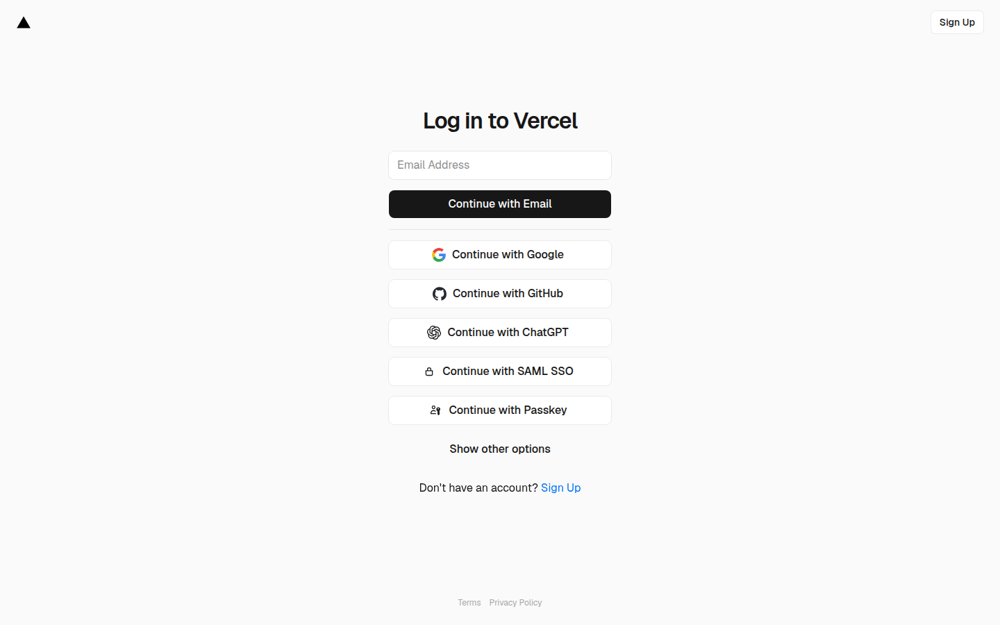
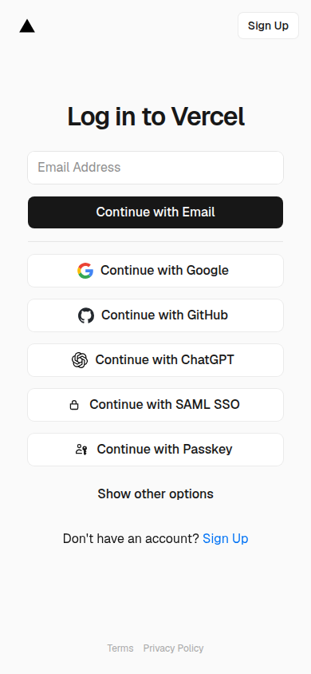

# Aceite personas C — MEMBRO, CONVIDADO, EDITOR_SITE e PUBLICADOR_SITE

Data: 2026-11-23. Issues: [#312](https://github.com/sistemaidbriachofundo-tech/igreja-deus-riacho-fundo-1/issues/312) e mestre [#309](https://github.com/sistemaidbriachofundo-tech/igreja-deus-riacho-fundo-1/issues/309).

Esta rodada cobre só a frente C. Não fecha as nove personas da #309 e não altera código de produto. Não houve deploy, merge, escrita em HML, main ou produção, nem pagamento real.

## Alvo

| Item | Valor |
| --- | --- |
| Branch candidata | `chatgpt/dev-prehml-final-gates-20261123` |
| SHA | `5f32bb3fd4006e8f3276721210e4664e5a59b6d3` |
| API | `https://id-riacho1-api-qa.vercel.app` |
| `GET /ready` | HTTP 200, `database=ok`, `authState=prisma`, `mfaBlocking=true`, `commit=5f32bb3fd400` |
| Frontend DEV | `https://id-riacho1-web-hml-git-0d6b26-gustavomarqueslopes-cmds-projects.vercel.app/` |
| Banco permitido | Neon `flat-tree-17047178`, branch QA `br-twilight-bonus-b6moawk7` |
| Banco proibido | HML `br-jolly-darkness-b6f5mzsy`, main e produção |
| Prefixo | `QA-PERSONA-C-20261123` |
| Igreja exercitada pela API | a congregação piloto já publicada no QA, evento `qa-acolhimento` (`qa_visual_acolhimento`) |

`GET /ready` confirma que a API QA desta rodada é a candidata. O executor não recebeu `DATABASE_URL` dessa branch. O antes/depois abaixo é o estado lido e gravado pela API QA. Nenhuma query SQL foi enviada.

## Como ler o veredito

- **HOSTED API**: chamada direta à API QA.
- **HOSTED UI**: navegador no frontend DEV. O SSO da Vercel não foi contornado.
- **LOCAL**: não foi usado como substituto de PASS hospedado. Não há PASS LOCAL nesta rodada.

Senha, token, telefone, código de QR e segredo TOTP não entram neste arquivo.

## Matriz

| Persona | Jornada | Camada | HTTP / estado | Veredito |
| --- | --- | --- | --- | --- |
| MEMBRO | Login da conta sintética documentada | HOSTED API | `POST /auth/login` 401 `INVALID_CREDENTIALS` | BLOCKED |
| MEMBRO | Minha Conta, Minha Escala, aceitar/recusar, inscrição e QR | HOSTED API | não executado: sem sessão | BLOCKED |
| MEMBRO | Negar tesouraria, pastoral e CMS | HOSTED API | não medido autenticado | BLOCKED |
| CONVIDADO | Criar conta sintética | HOSTED API | `POST /auth/guest-registration` 201, papel só `CONVIDADO`, `GET /auth/me` 200 | PASS |
| CONVIDADO | Voltar ao mesmo evento | HOSTED API | logout e novo login devolvem `resume.eventSlug=qa-acolhimento` | PASS |
| CONVIDADO | Minha Conta, telefone | HOSTED API | telefone nulo → PATCH 200 alterou → PATCH null restaurou nulo | PASS |
| CONVIDADO | Inscrição gratuita e QR próprio | HOSTED API | 201 `CONFIRMED` / `CONFIRMED_MOCK`, `checkInCode` de 32 caracteres relido após novo login | PASS |
| CONVIDADO | Isolar inscrição de outra pessoa | HOSTED API | dono 200 com QR; outro convidado 404 sem `checkInCode` | PASS |
| CONVIDADO | Negar área interna | HOSTED API | ledger, pastoral, CMS, escalas, membros e eventos administrativos 403; anônimo 401 | PASS |
| CONVIDADO | Repetir a mesma inscrição | HOSTED API | lista 1 `CONFIRMED` → segundo POST 201 com outro id → lista 2 `CONFIRMED` | FAIL |
| CONVIDADO | Scanner sem grant | HOSTED API | `POST /events/qa_visual_acolhimento/tickets/scan` 403 | PASS |
| EDITOR_SITE | Sessão, rascunho e prévia | HOSTED API | `POST /auth/login` 401 `INVALID_CREDENTIALS` | BLOCKED |
| PUBLICADOR_SITE | Publicar conteúdo sintético | HOSTED API | `POST /auth/login` 401 `INVALID_CREDENTIALS` | BLOCKED |
| EDITOR / PUBLICADOR | 403 tesouraria e pastoral autenticado | HOSTED API | sem sessão; o 403 desses papéis não foi medido | BLOCKED |
| Scanner | Grant, QR duplicado e QR de outro evento | HOSTED API | `event_scanner_grants` informado como 0 na #309; criar grant exige papel com MFA | BLOCKED |
| Todas | UI 1440 e 390 | HOSTED UI | 302 para login da Vercel | BLOCKED |
| Todas | Conferência SQL | Banco QA | `DATABASE_URL` ausente neste executor | BLOCKED |

## CONVIDADO — o que a API mostrou

Contas criadas só com e-mail `@example.test` e nome no prefixo. A senha foi gerada na execução e descartada. Não houve e-mail nem WhatsApp real.

1. `qa-persona-c-20261123-convidado@example.test` — cadastro e uma inscrição em `qa-acolhimento`.
2. `qa-persona-c-20261123-convidado-b@example.test` — telefone alterado e restaurado para nulo; uma inscrição; QR relido depois do logout.
3. `qa-persona-c-20261123-iso-owner@example.test` — duas inscrições confirmadas no mesmo lote gratuito.
4. `qa-persona-c-20261123-iso-other@example.test` — sessão sem inscrição, usada só para ler a inscrição alheia.

Evento público `qa-acolhimento`: lote gratuito (`priceCents=0`), `ticketPolicy=REGISTRATION`. A política não emite ingresso por participante quando o grupo tem uma pessoa. O QR da inscrição é o `checkInCode`. Ele veio na criação, no detalhe do dono e de novo depois do login. O código não foi copiado para este relatório. `GET /public/registrations/:checkInCode` respondeu 200 com o slug `qa-acolhimento`.

Antes/depois do telefone, só pela API: nulo, valor sintético gravado, nulo outra vez. O número não fica registrado aqui.

Áreas internas do convidado, todas HTTP 403:

- `GET /ledger/accounts`
- `GET /pastoral-cases`
- `GET /cms/contents`
- `GET /rosters/me`
- `GET /rosters/by-ministry/qa-persona-c-inexistente`
- `GET /memberships`
- `GET /events`

Sem sessão, as mesmas rotas respondem 401.

A segunda inscrição do mesmo convidado, no mesmo evento e lote, não reaproveitou o id. A lista passou de 1 para 2, as duas `CONFIRMED`. O contrato versionado não recusa essa repetição, então não houve correção de código nesta rodada.

## MEMBRO, EDITOR_SITE e PUBLICADOR_SITE

A senha documentada no README do seed tem 5 caracteres e foi tentada uma vez, sem variação, nestas contas sintéticas já versionadas:

- `bruno.demo@example.test` — MEMBRO
- `editor.demo@example.test` — EDITOR_SITE
- `publicador.demo@example.test` — PUBLICADOR_SITE

As três responderam 401 `INVALID_CREDENTIALS`. Não houve outra tentativa. `QA_DEMO_PASSWORD` do ambiente QA e o segredo TOTP não estão neste executor. EDITOR e PUBLICADOR, quando a senha passar, ainda exigem MFA (`mfaBlocking=true`; esses papéis não estão na exceção de MEMBRO/CONVIDADO). O enrollment não foi iniciado.

Por isso ficam bloqueados: Minha Escala, aceitar/recusar, inscrição do membro, rascunho, prévia, publicação sintética e o 403 autenticado de tesouraria/pastoral desses dois papéis de mídia. O 403 do convidado não substitui o 403 do editor.

## Check-in

O convidado sem grant recebeu 403 ao tentar ler um código inválido. Isso mostra a recusa de quem não é scanner. Grant, QR duplicado e QR de outro evento continuam bloqueados: a #309 registrou `event_scanner_grants=0`, e criar grant exige líder, secretaria, pastor ou administração, todos com MFA.

## UI hospedada

O frontend DEV responde 302 para `https://vercel.com/sso-api`. O SSO não foi removido nem ignorado. A tela da igreja não abriu.

Não há screenshot de Minha Conta, escala, inscrição ou CMS hospedados. Essas telas estão atrás do SSO.

## Banco

Bloqueado para SQL direto. A API QA no commit `5f32bb3fd400` persistiu as contas e inscrições do prefixo: a lista e o detalhe continuam depois do logout. Isso não é uma contagem lida em `event_scanner_grants` nem em `roster_assignment_responses`. A branch HML não foi contactada.

## Lista para a #309

- **P0 de aceite, sem patch:** MEMBRO, EDITOR_SITE e PUBLICADOR_SITE não entram com a senha documentada do seed. Falta a credencial QA autorizada e, para mídia, o TOTP. A frente C não fecha enquanto isso.
- **P1:** nenhum. As recusas medidas do convidado foram 403 de verdade, e o QR alheio não vazou.
- **P2:** repetir a inscrição gratuita cria outra inscrição confirmada. Sem regra versionada de unicidade, não houve correção.

Nenhuma PR de correção de produto foi aberta. Não há defeito de código comprovado além do P2, e esse P2 não tem contrato que autorize mudar a regra agora.
